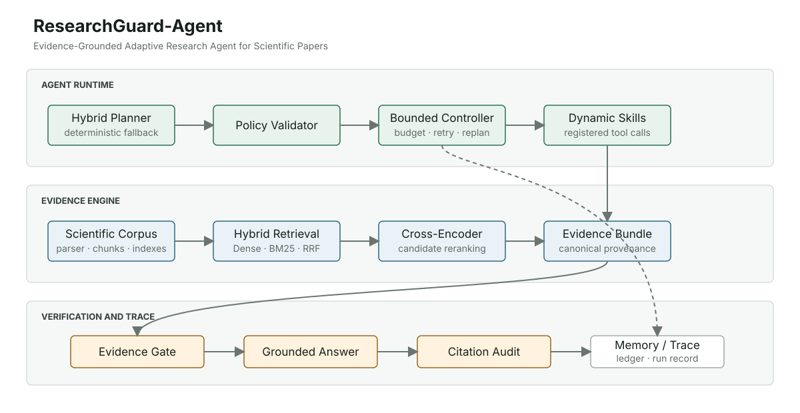
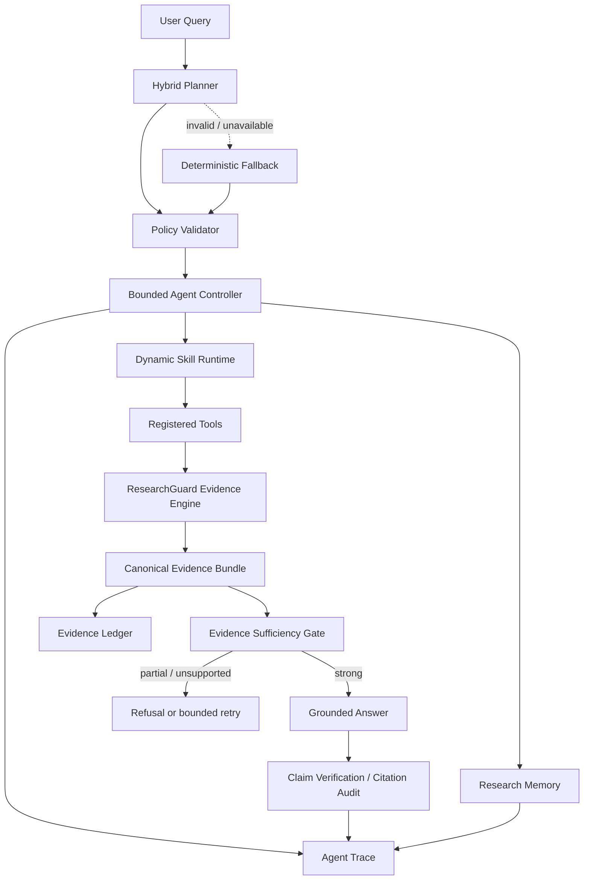

# ResearchGuard-Agent

**Evidence-Grounded Adaptive Research Agent for Scientific Papers**

面向科研论文的受约束 Evidence-grounded Research Agent：通过 Hybrid Planning、Dynamic Skill Composition 与 Evidence Verification，完成可追溯、可拒答、可审计的科研检索、论文比较和 claim audit。

ResearchGuard-Agent 不是普通 PDF 问答 Demo。系统把科研文献解析与检索能力封装为受控 Tools，由单 Agent Controller 在预算、Policy Validator、Evidence Gate 和 Citation Audit 的共同约束下执行。它不会把检索片段直接包装成答案，也不宣称 fully autonomous researcher、AGI 或开放式自主研究。

## System Architecture





系统分为两层：

- **Agent Runtime**：理解任务、生成有限计划、校验计划、组合 Skills、调用 Tools、管理预算、失败恢复、记录 Trace。
- **Evidence Engine**：解析论文、构建 section-aware chunks、Hybrid Retrieval、Reranking、Evidence Sufficiency、Grounded Generation 与 Citation Audit。

`researchguard.pipeline.ResearchGuardPipeline` 是 Evidence Engine 的统一入口；`researchguard.agent.BoundedResearchAgentController` 是 Agent 路径入口。Demo、CLI 和 FastAPI 只调用这两个入口，不复制核心算法。

## Agent Capabilities

| Capability | Current implementation | Boundary |
|---|---|---|
| Bounded agent | 单 Controller，限制 steps、tool calls、retry、revision 与 timeout | 没有无限 ReAct 或开放式自治循环 |
| Adaptive planning | Hybrid LLM Planner + strict schema + deterministic fallback | LLM 只能提议计划，不能执行 Tool 或扩大 Policy |
| Dynamic skill composition | Validator 校验后的线性 Skill sequence | 不支持任意 DAG、动态代码或并行 Agent |
| Tool execution | Registry 统一暴露 Retrieval、Evidence、Answer、Audit、Scholarly Search | Tool Facade 不重写 Evidence Engine |
| Failure recovery | 对 retrieval miss、partial evidence 和执行失败进行 bounded replanning | `max_plan_revisions <= 2` |
| Evidence grounding | Canonical `chunk_id/page/section`、EvidenceBundle、GateDecision | 外部论文 metadata 不能直接成为证据 |
| Safe generation | Evidence Gate → Answer Generation → Citation Audit | partial/unsupported 不允许生成 |
| Traceability | plan、skills、tools、evidence、gate、answer、audit、memory 全链路 Trace | Trace 不等同于模型隐藏推理 |

### Hybrid Planner

```text
Query
→ Hybrid Planner proposes StructuredPlan
→ PlannerValidator checks schema, skills, tools, budgets and ordering
→ Controller executes validated Skills

Planner API / JSON / schema / policy failure
→ DeterministicPlanner
→ same PlannerValidator
→ Controller
```

计划包含 `task_type`、`goal`、`skills`、`budget`、`reasoning_summary` 和 `planner_version`。Validator 会拒绝未知 Skill、预算越界、Evidence Gate bypass、未审计生成和非法重试。当前 Planner A/B 中 Hybrid 路径全部 fallback，因此项目不把这组结果表述为 LLM Planner 质量提升。

### Dynamic Skills

默认 Registry 提供以下受控 Skills：

- `search_papers`
- `retrieve_evidence`
- `assess_evidence`
- `analyze_claims`
- `compare_evidence`
- `audit_claims`
- `generate_report`

`generate_report` 是受保护复合 Skill，内部强制执行或复用 Evidence Gate，并在返回前完成 Citation Audit。`literature_review`、`paper_comparison` 和 `claim_audit` 使用有限模板，但 Controller 仍逐 Skill 执行和记录。

### Controller and Recovery

Controller 管理序列化 `ResearchAgentState`、执行预算、观察结果、重试和最多两次 plan revision。典型 QA 路径为：

```text
retrieve_evidence
→ generate_report
    → assess_evidence
    → generate_grounded_answer
    → audit_answer
```

当检索为空或 coverage 低时，Controller 可扩大检索或触发 scholarly metadata discovery；metadata 只作为候选论文信息，必须经过用户选择、PDF ingestion、Parser 和 Index 后才可能成为 canonical evidence。

## Evidence Engine

```text
PDF
→ PyMuPDF Layout Extraction
→ Noise Filtering
→ Column Detection
→ Reading-order Recovery
→ Line-to-block
→ Block Type Classification
→ Heading Classification
→ Section Recovery
→ Section-aware Chunking
→ Dense + BM25 + Chroma Indexes
→ Query Rewrite / Multi-query
→ Hybrid Retrieval + RRF
→ Cross-Encoder Reranker
→ Evidence Sufficiency Gate
→ Grounded Answer
→ Claim-level Citation Audit
```

### Parsing and Chunking

- PyMuPDF 读取 text、span、font 与 bbox；估计 body font size，识别单栏/双栏并恢复阅读顺序。
- Block Detector 将 line 合并为 paragraph、heading、caption、table、equation 和 reference entry。
- Heading Classifier 同时使用字体、编号、长度、位置等正向特征，以及年份、conference、proceedings、arXiv、表格数值等负向特征。
- Section Recovery 统一 aliases，通过 soft transition 在 block level 恢复 section；page-level dominant section 只用于汇总，不替代 block-level provenance。
- Chunking 在 section 变化处强制切断，绑定 heading path，按句拆分长 block，同 section 合并短 chunk，并保留 equation、caption、table 与 overlap provenance。

Parser v5 已通过 reading order、heading、block-level section 和 references 严格验收。Chunking v1 的 synthetic invariants 与五篇真实论文硬性检查通过，状态为 `APPROVED_FOR_INDEXING`。

### Retrieval and Verification

- Query Rewrite 保留原 query 与关键实体，支持 normalized query、最多两个 expansion queries、缓存与失败回退。
- Dense 与 BM25 候选通过 Reciprocal Rank Fusion 合并，再由 Cross-Encoder 精排。
- `EvidenceRecord` 保留 canonical `chunk_id`、`doc_id`、`section`、`page`、content、source、score 和 provenance。
- Evidence Sufficiency 将证据判为 `strong`、`partial` 或 `unsupported`。
- Answer Generator 只允许引用 GateDecision 绑定的 EvidenceBundle。
- Citation Audit 将答案拆为 atomic claims，逐 claim 验证 support level 和 canonical citation。

### Tool Facade

`researchguard/tools/` 为 Agent 提供稳定 JSON contract：

| Tool | Existing capability | Output |
|---|---|---|
| `retrieve_evidence` | Rewrite、Hybrid Retrieval、Chroma、Reranker | `ToolResult[EvidenceBundle]` |
| `assess_evidence` | Evidence Sufficiency | `GateDecision` |
| `generate_grounded_answer` | Guarded Answer Pipeline | `AnswerArtifact` 或拒答 |
| `audit_answer` | Claim Verification / Citation Audit | claim-level audit |
| `search_scholarly_sources` | arXiv / OpenAlex metadata search | non-evidence candidate metadata |

所有 contract 带 schema version、trace ID、timestamp、latency 和结构化 error。`EvidenceBundle.bundle_id` 与 `GateDecision.evidence_bundle_id` 防止 gate 与生成证据错配。

## Research Memory and Trace

Research Memory 是受限的科研过程记忆，不是第二套检索系统：

- **Run Store**：保存 query、task type、plan、status 和产物引用。
- **Evidence Ledger**：保存 claim 与 canonical evidence 的支持关系。
- **Failure Memory**：记录失败类型与有限恢复信息。
- **Advisory Context**：只向 Planner 提供有界历史摘要，不能改变当前证据或绕过 Gate。

Agent Trace 记录 plan、plan revisions、Skill timeline、Tool calls、EvidenceBundle、GateDecision、Answer、Audit 与 Memory 状态。Streamlit Demo 和 FastAPI 返回这些结构化信息，便于展示和复核。

## Evaluation

### Retrieval

40 条固定 retrieval benchmark 的主要结果：

| Pipeline | Recall@10 | MRR@10 | nDCG@10 |
|---|---:|---:|---:|
| Raw Hybrid | 0.9444 | 0.6847 | 0.6197 |
| Hybrid + Reranker | **0.9722** | **0.7394** | **0.6626** |
| Multi-query + Reranker | **0.9722** | **0.7394** | 0.6468 |

Multi-query 保持 Recall/MRR，但 nDCG 略低于 Raw Hybrid + Reranker，因此不会默认宣称所有 query 都从扩展中受益。

### Agent Benchmark v3

2026-07-27 完整真实运行结果：

| Metric | Result |
|---|---:|
| Cases | 50 |
| Overall pass rate | **1.0000** |
| Literature Research | **20/20** |
| Paper Comparison | **15/15** |
| Claim Audit | **15/15** |
| Task classification accuracy | 1.0000 |
| Skill selection accuracy | 1.0000 |
| Plan validity | 1.0000 |
| Provenance validity | 1.0000 |
| Gate bypass attempts | **0** |

该 benchmark 评估 routing、Skill execution、safety boundary 与 provenance，不代表“100% Agent accuracy”，也不等同于开放域科研质量。优化前基线为 0.60，Paper Comparison 为 0.2667、Claim Audit 为 0.4667，并出现 6 次 gate bypass hard-check；这些失败推动了 paper identity separation、atomic claim verification 和统一 generation boundary 修复。

### Independent Holdout v1

Holdout 使用独立 10 篇论文、637 chunks 和 25 条 blind questions：

| Metric | Result |
|---|---:|
| Conclusion | `PASS` |
| Pass rate | **0.8800 (22/25)** |
| Answer/refusal correctness | 0.9600 |
| Completion rate | 0.9600 |
| Document hit/coverage@10 | 0.9200 |
| Task classification accuracy | 0.9200 |
| Skill sequence accuracy | 0.9200 |
| Provenance validity | 1.0000 |
| Gate bypass attempts | **0** |

剩余 3 条失败包括 2 条 deterministic Planner routing mismatch 和 1 条 external API failure。Holdout 结果比同一评测流程的初始 0.4800 有明显改善，但仍不是开放域泛化保证。

### Planner A/B

结论为 `INCONCLUSIVE_FALLBACK_ONLY`。Deterministic 与 Hybrid 在 50 条标注上的 routing、sequence、completeness 和 validity 相同，但 Hybrid 50/50 全部 fallback，产生 50 次 API 调用、71,589 input tokens 与 13,380 output tokens，没有可证明的质量增益。这一结果被保留为真实限制。

## Project Structure

```text
researchguard/
├── agent/           # Hybrid Planner, Validator, Controller, replanning, state
├── skills/          # Skill contracts, registry, executor, runtime, templates
├── tools/           # Evidence contracts and Agent Tool Facade
├── workflows/       # Literature review, paper comparison, claim audit
├── ingestion/       # Parser v5 and section-aware chunking
├── indexing/        # Dense, BM25 and Chroma index construction
├── retrieval/       # Rewrite, retrieval, reranking, gate, answer and audit
├── memory/          # Run memory, evidence ledger and failure memory
├── tracing/         # Agent trace collection and formatting
├── evaluation/      # Benchmark v3, holdout and planner comparison
├── audit/           # Claim/evidence audit skills
└── reporting/       # Structured report renderers

api/                 # FastAPI service
demo/                # Streamlit Demo v3
configs/             # Versioned runtime configuration
scripts/             # Build and validation entry points
tests/               # Unit, policy, facade, workflow and evaluation tests
data/eval/           # Public benchmark labels only
docs/images/         # README architecture assets
```

Generated data、indexes、models、cache、memory snapshots 与 outputs 均由 `.gitignore` 排除。

### Deprecated Entrypoints

以下文件仅为历史兼容或迁移审计保留，不是当前运行入口：

- `frontend/streamlit_app.py`：旧 Streamlit 原型；当前入口是 `demo/app.py`。
- `main.py`：早期 IDE 示例；不参与 ResearchGuard。
- `researchguard/agent/legacy_agentic_rag.py`：旧 Agent 兼容实现。
- `researchguard/ingestion/parse_pdf_old.py`：旧 Parser 兼容实现。
- `PROJECT_CLEANUP_REPORT.md`：历史清理与依赖审计记录。

项目不删除这些文件，以避免破坏历史入口；新开发不应依赖它们。

## Quick Start

### 1. Clone

```powershell
git clone https://github.com/Xzh1844963039/ResearchGuard-Agent.git
cd ResearchGuard-Agent
```

### 2. Create Environment

Windows PowerShell：

```powershell
py -3.11 -m venv .venv
.\.venv\Scripts\Activate.ps1
python -m pip install --upgrade pip
python -m pip install -e .
```

也可安装锁定的本地开发依赖：

```powershell
python -m pip install -r requirements.txt
```

### 3. Configure API Keys

```powershell
$env:OPENAI_API_KEY = "your-key"
```

可选 OpenAlex metadata provider：

```powershell
$env:OPENALEX_API_KEY = "your-key"
```

不要提交 `.env`、API key、cache、model、index、PDF 或生成输出。

### 4. Prepare Local Corpus

仓库不包含论文 PDF、解析产物或向量索引。将本地 PDF 放入被忽略的数据目录后，按当前配置运行 Parser、Chunking 与 Indexing：

```powershell
python -m researchguard.ingestion.parse_pdf `
    --input "data/raw_docs/my_paper.pdf" `
    --out_dir "data/parsed/my_paper"

python scripts/build_chunks_v1.py `
    --blocks "data/parsed/my_paper/blocks.jsonl" `
    --output "data/parsed/my_paper/chunks.jsonl" `
    --doc_id "my_paper"

python scripts/build_index_v1.py
python scripts/build_chroma_v1.py
```

具体输入/输出目录由 `configs/` 中的版本化 YAML 控制。

### 5. Run the Agent CLI

```powershell
python -m researchguard.cli agent-run "How does CRAG reduce hallucination?"
```

Evidence Engine 单流程：

```powershell
python -m researchguard.cli run "What is the difference between RAG-Sequence and RAG-Token?"
```

### 6. Run the Demo

```powershell
python -m streamlit run demo/app.py
```

打开 `http://127.0.0.1:8501`。Demo 展示 Generated Plan、Skill/Tool execution trace、canonical evidence、Evidence Gate、Grounded Answer、Citation Audit、Evidence Ledger 与 run memory。页面不会显示 API key、环境变量或本地绝对路径。

### 7. Run the API

```powershell
python -m uvicorn api.app:app --host 127.0.0.1 --port 8000
```

健康检查：

```powershell
Invoke-RestMethod http://127.0.0.1:8000/health
```

研究请求：

```powershell
$body = @{
    query = "How does CRAG reduce hallucination?"
    workflow = "literature_review"
} | ConvertTo-Json

Invoke-RestMethod `
    -Method Post `
    -Uri http://127.0.0.1:8000/research `
    -ContentType "application/json" `
    -Body $body
```

`POST /research` 返回：

```text
plan
planner
skills
tool_calls
evidence_bundle
evidence
answer
audit
memory
plan_revisions
```

OpenAPI 文档位于 `http://127.0.0.1:8000/docs`。

### 8. Run Tests

```powershell
python -m compileall researchguard api scripts
python -m unittest discover -s tests -v
python scripts/validate_pipeline_v1.py
python scripts/validate_agent_benchmark_v3.py
python scripts/compare_planners_v1.py
python scripts/validate_api_v1.py
```

## Design Decisions

1. **ResearchGuard Core remains authoritative.** Agent Tools 只适配输入输出，不复制 Retrieval、Reranker、Gate、Generation 或 Audit。
2. **Canonical evidence is immutable across layers.** `chunk_id/page/section` 从 Parser 到 Citation Audit 始终保留。
3. **Generation is protected.** 不暴露裸 `generate_answer()`；唯一 Agent 接口是受 Evidence Gate 与 Citation Audit 约束的 `generate_grounded_answer()`。
4. **Metadata is not evidence.** arXiv/OpenAlex 结果不能直接支持答案。
5. **Planner proposes, policy decides.** LLM Planner 失败或输出非法计划时 fail closed 并回退确定性 Planner。
6. **Single Agent before Multi-Agent.** 当前任务复杂度不需要引入 LangGraph、AutoGPT 或多 Agent 协议。

## Limitations

- 当前是 bounded single-agent system，不是 fully autonomous researcher。
- 没有 Multi-Agent、LangGraph、无限 ReAct、开放式 autonomous web research 或运行时代码生成。
- 公开仓库不包含受版权和体积限制的论文语料、Chroma indexes、模型权重与生成 outputs。
- OCR fallback 尚未接入默认 Parser 主流程；扫描 PDF 需要显式 OCR 配置。
- 复杂跨栏表格仍有限；caption/table/equation 主要按版面顺序与邻近上下文绑定，不是完整视觉语义理解。
- Corpus 规模有限；Retrieval benchmark、Agent Benchmark v3 与 holdout 不能代表开放域泛化。
- Benchmark v3 验证 routing、execution、safety 与 provenance，不验证所有科研结论的专家级正确性。
- Holdout v1 仍有 2 条 Planner routing mismatch 与 1 条 external API failure。
- Planner A/B 全部 fallback，尚无 LLM Planner 优于 deterministic Planner 的有效证据。
- Research Memory 只提供 advisory context，不做长期用户画像或跨项目知识学习。
- FastAPI 和 Streamlit 面向本地展示，尚未实现认证、并发配额、在线部署和生产监控。
- 历史代码中仍可能存在早期乱码或本地绝对路径注释；运行时展示会对路径与敏感字段做脱敏。

## Current Status

| Area | Status |
|---|---|
| Parser v5 | Completed and validated |
| Section-aware Chunking | Completed; approved for indexing |
| Dense/BM25/Chroma Indexing | Completed |
| Hybrid Retrieval + Reranker | Completed and benchmarked |
| Evidence Gate + Grounded Generation + Citation Audit | Completed |
| Tool Facade + Evidence Contracts | Completed |
| Bounded Controller + Hybrid Planner + Dynamic Skills | Completed |
| Research Memory + Evidence Ledger + Trace | Completed |
| Agent Benchmark v3 | `PASS`, 50/50, hard checks 0 |
| Independent Holdout v1 | `PASS`, 22/25 |
| Planner A/B | `INCONCLUSIVE_FALLBACK_ONLY` |
| FastAPI + Streamlit Demo v3 | Completed for local use |
| Production deployment / auth / monitoring | Not implemented |

## Development Documentation Rule

今后每次新增或修改功能、调整目录、增加脚本、改变运行命令、更新验证结果或推进项目阶段时，必须同步更新 `README.md`。每次至少同步：

- 当前状态
- 数据流与架构
- 核心文件
- 方法说明
- 运行命令
- 输出目录
- 验证结果
- 已知限制
- 下一步计划

若某次任务明确禁止修改 README，应在交付时说明 README 尚未同步。
