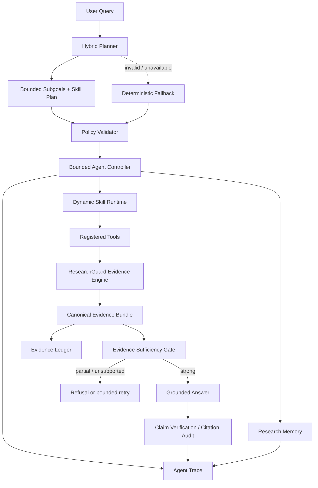

# ResearchGuard-Agent

**Evidence-Grounded Adaptive Research Agent for Scientific Papers**

面向科研论文的受约束 Evidence-grounded Research Agent：通过 Hybrid Planning、bounded goal decomposition、Dynamic Skill Composition 与 Evidence Verification，完成可追溯、可拒答、可审计的科研检索、论文比较和 claim audit。

ResearchGuard-Agent 不是普通 PDF 问答 Demo。系统把科研文献解析与检索能力封装为受控 Tools，由单 Agent Controller 在预算、Policy Validator、Evidence Gate 和 Citation Audit 的共同约束下执行。它不会把检索片段直接包装成答案，也不宣称 fully autonomous researcher、AGI 或开放式自主研究。

## System Architecture




系统分为两层：

- **Agent Runtime**：理解任务、生成有限计划、校验计划、组合 Skills、调用 Tools、管理预算、失败恢复、记录 Trace。
- **Evidence Engine**：解析论文、构建 section-aware chunks、Hybrid Retrieval、Reranking、Evidence Sufficiency、Grounded Generation 与 Citation Audit。

`researchguard.pipeline.ResearchGuardPipeline` 是 Evidence Engine 的统一入口；`researchguard.agent.BoundedResearchAgentController` 是 Agent 路径入口。Demo、CLI 和 FastAPI 只调用这两个入口，不复制核心算法。

## Agent Capabilities

| Capability | Current implementation | Boundary |
|---|---|---|
| Bounded agent | 单 Controller，限制 steps、tool calls、retry、revision 与 timeout；每次 Tool invoke 前检查预算 | 默认最多 6 steps、14 tool calls、2 revisions |
| Adaptive planning | Hybrid LLM Planner + strict schema + deterministic fallback | LLM 只能提议计划，不能执行 Tool 或扩大 Policy |
| Goal decomposition | 最多 4 个带独立 query 与成功条件的 research subgoals | 只支持 QA / literature review 的线性有界计划 |
| Dynamic skill composition | Validator 校验后的线性 Skill sequence | 不支持任意 DAG、动态代码或并行 Agent |
| Tool execution | Registry 统一暴露 Retrieval、Evidence、Answer、Audit、Scholarly Search | Tool Facade 不重写 Evidence Engine |
| Failure recovery | 局部 Gate 驱动 query replacement；aggregate Gate 缺口可插入一个 runtime subgoal | `max_plan_revisions <= 2`，不支持任意计划改写 |
| Evidence grounding | Canonical `chunk_id/page/section`、EvidenceBundle、GateDecision | 外部论文 metadata 不能直接成为证据 |
| Safe generation | Evidence Gate → Answer Generation → Citation Audit | partial/unsupported 不允许生成 |
| Traceability | Trace v4 记录 completed/missing objectives、Gate observation、subgoal change 与最终决策 | 结构化决策解释，不记录模型隐藏推理 |

### Hybrid Planner

```text
Query
→ Hybrid Planner proposes StructuredPlan
→ PlannerValidator checks schema, skills, tools, budgets and ordering
→ Controller executes validated Skills

Planner API / JSON / schema / policy failure
→ DeterministicPlanner
→ same PlannerValidator
→ Controller
```

Structured Plan v2 包含 `task_type`、`goal`、可选 `subgoals`、`skills`、`budget`、`reasoning_summary` 和 `planner_version`。每个 subgoal 保存稳定 ID、独立 research question、objective 与 success criterion；检索 step 必须绑定对应 `subgoal_id` 和完全一致的 step-local query。Validator 允许不同 subgoal 合理复用 `retrieve_evidence`，同时拒绝同一 subgoal 的重复检索、未知参数、预算越界、Evidence Gate bypass、未审计生成和非法顺序。

`expected_observation` 由 Skill Registry 的实际输出契约确定，不再依赖 LLM 猜测类型字符串；step-local query 则从对应 subgoal question 确定性派生，避免两个重复字段漂移。Hybrid Planner 明确禁止只生成一个 subgoal；若模型仍返回单 subgoal，契约归一化会把它收敛为简单计划，再交给同一 Validator。LLM 仍不能自行放宽预算、注册 Skill 或绕过 protected generation。

历史 Planner A/B v1 的 50 个 Hybrid case 全部 fallback，该结果仍保留。新的 Planner A/B v2 使用 5 条无 chunk-id 标注的真实开放目标运行完整 Agent 链路；Hybrid 5/5 均为 `hybrid_llm`、fallback 0，但结论仅为 `HYBRID_STRUCTURAL_GAIN_ONLY`，详见 Evaluation。它证明当前 Planner 能稳定产出合法计划，不证明完成率优于 deterministic baseline。

### Dynamic Skills

默认 Registry 提供以下受控 Skills：

- `search_papers`
- `retrieve_evidence`
- `assess_evidence`
- `analyze_claims`
- `compare_evidence`
- `audit_claims`
- `generate_report`

`generate_report` 是受保护复合 Skill，内部强制执行或复用 Evidence Gate，并在返回前完成 Citation Audit。`literature_review`、`paper_comparison` 和 `claim_audit` 使用有限模板，但 Controller 仍逐 Skill 执行和记录。

### Controller and Recovery

Controller 管理序列化 `ResearchAgentState`、执行预算、观察结果、重试和最多两次 plan revision。典型 QA 路径为：

```text
retrieve_evidence
→ generate_report
    → assess_evidence
    → generate_grounded_answer
    → audit_answer
```

当检索为空或 coverage 低时，Controller 可扩大检索或触发 scholarly metadata discovery；metadata 只作为候选论文信息，必须经过用户选择、PDF ingestion、Parser 和 Index 后才可能成为 canonical evidence。

开放目标的有界路径为：

```text
Research Goal
→ 2-4 bounded subgoals when independent evidence needs exist
→ each subgoal uses its own validated retrieval query
→ Controller stores one canonical EvidenceBundle per subgoal
→ subgoal Gate evaluates question + objective + success criterion
→ only strong Gate marks the subgoal satisfied
→ partial/unsupported observation replaces only that subgoal query
→ aggregate by chunk_id while preserving source bundle provenance
→ final aggregate Gate checks that decomposition did not omit the original goal
→ an unresolved aggregate gap may insert one bounded runtime subgoal
→ repeated miss becomes metadata-only discovery and fail-closed refusal
→ strong aggregate evidence proceeds to Generation and Citation Audit
```

每个局部门控使用同一组 canonical `EvidenceRecord` 创建独立 assessment bundle，GateDecision 与该 bundle ID 绑定；它不会把 metadata 或新文本变成 evidence。最终 aggregate Gate 仍保留，用于防止 Planner 漏拆原目标。已满足 subgoal 不会因另一个 subgoal 缺证而重跑，原计划中未受影响的未来步骤会被保留。`ResearchAgentState` v3 与 Agent Trace v4 记录 attempts、criterion result、source/assessment bundle、completed/missing objectives、observation、subgoal change 和当前计划。

## Evidence Engine

```text
PDF
→ PyMuPDF Layout Extraction
→ Noise Filtering
→ Column Detection
→ Reading-order Recovery
→ Line-to-block
→ Block Type Classification
→ Heading Classification
→ Section Recovery
→ Section-aware Chunking
→ Dense + BM25 + Chroma Indexes
→ Query Rewrite / Multi-query
→ Hybrid Retrieval + RRF
→ Cross-Encoder Reranker
→ Evidence Sufficiency Gate
→ Grounded Answer
→ Claim-level Citation Audit
```

### Parsing and Chunking

- PyMuPDF 读取 text、span、font 与 bbox；估计 body font size，识别单栏/双栏并恢复阅读顺序。
- Block Detector 将 line 合并为 paragraph、heading、caption、table、equation 和 reference entry。
- Heading Classifier 同时使用字体、编号、长度、位置等正向特征，以及年份、conference、proceedings、arXiv、表格数值等负向特征。
- Section Recovery 统一 aliases，通过 soft transition 在 block level 恢复 section；page-level dominant section 只用于汇总，不替代 block-level provenance。
- Chunking 在 section 变化处强制切断，绑定 heading path，按句拆分长 block，同 section 合并短 chunk，并保留 equation、caption、table 与 overlap provenance。

Parser v5 已通过 reading order、heading、block-level section 和 references 严格验收。Chunking v1 的 synthetic invariants 与五篇真实论文硬性检查通过，状态为 `APPROVED_FOR_INDEXING`。

### Retrieval and Verification

- Query Rewrite 保留原 query 与关键实体，支持 normalized query、最多两个 expansion queries、缓存与失败回退。
- Dense 与 BM25 候选通过 Reciprocal Rank Fusion 合并，再由 Cross-Encoder 精排。
- `EvidenceRecord` 保留 canonical `chunk_id`、`doc_id`、`section`、`page`、content、source、score 和 provenance。
- Evidence Sufficiency 将证据判为 `strong`、`partial` 或 `unsupported`。
- Answer Generator 只允许引用 GateDecision 绑定的 EvidenceBundle。
- Citation Audit 将答案拆为 atomic claims，逐 claim 验证 support level 和 canonical citation。

### Tool Facade

`researchguard/tools/` 为 Agent 提供稳定 JSON contract：

| Tool | Existing capability | Output |
|---|---|---|
| `retrieve_evidence` | Rewrite、Hybrid Retrieval、Chroma、Reranker | `ToolResult[EvidenceBundle]` |
| `assess_evidence` | Evidence Sufficiency | `GateDecision` |
| `generate_grounded_answer` | Guarded Answer Pipeline | `AnswerArtifact` 或拒答 |
| `audit_answer` | Claim Verification / Citation Audit | claim-level audit |
| `search_scholarly_sources` | arXiv / OpenAlex metadata search | non-evidence candidate metadata |

所有 contract 带 schema version、trace ID、timestamp、latency 和结构化 error。`EvidenceBundle.bundle_id` 与 `GateDecision.evidence_bundle_id` 防止 gate 与生成证据错配。

## Research Memory and Trace

Research Memory 是受限的科研过程记忆，不是第二套检索系统：

- **Run Store**：保存 query、task type、plan、status 和产物引用。
- **Evidence Ledger**：保存 claim 与 canonical evidence 的支持关系。
- **Failure Memory**：记录失败类型与有限恢复信息。
- **Advisory Context**：只向 Planner 提供有界历史摘要，不能改变当前证据或绕过 Gate。

Agent Trace 记录 plan、plan revisions、Skill timeline、Tool calls、EvidenceBundle、GateDecision、Answer、Audit 与 Memory 状态。Streamlit Demo 和 FastAPI 返回这些结构化信息，便于展示和复核。

## Evaluation

### Retrieval

40 条固定 retrieval benchmark 的主要结果：

| Pipeline | Recall@10 | MRR@10 | nDCG@10 |
|---|---:|---:|---:|
| Raw Hybrid | 0.9444 | 0.6847 | 0.6197 |
| Hybrid + Reranker | **0.9722** | **0.7394** | **0.6626** |
| Multi-query + Reranker | **0.9722** | **0.7394** | 0.6468 |

Multi-query 保持 Recall/MRR，但 nDCG 略低于 Raw Hybrid + Reranker，因此不会默认宣称所有 query 都从扩展中受益。

### Agent Benchmark v3

2026-09-08 完整真实回归结果：

| Metric | Result |
|---|---:|
| Cases | 50 |
| Overall pass rate | **1.0000** |
| Literature Research | **20/20** |
| Paper Comparison | **15/15** |
| Claim Audit | **15/15** |
| Task classification accuracy | 1.0000 |
| Skill selection accuracy | 1.0000 |
| Plan validity | 1.0000 |
| Provenance validity | 1.0000 |
| Gate bypass attempts | **0** |
| Successful completion | 0.4600 |

该 benchmark 评估 routing、Skill execution、safety boundary 与 provenance，不代表“100% Agent accuracy”，也不等同于开放域科研质量。优化前基线为 0.60，Paper Comparison 为 0.2667、Claim Audit 为 0.4667，并出现 6 次 gate bypass hard-check；这些失败推动了 paper identity separation、atomic claim verification 和统一 generation boundary 修复。

### Independent Holdout v1

Holdout 使用独立 10 篇论文、637 chunks 和 25 条 blind questions：

| Metric | Result |
|---|---:|
| Conclusion | `PASS` |
| Pass rate | **0.8800 (22/25)** |
| Answer/refusal correctness | 0.9600 |
| Completion rate | 0.9600 |
| Document hit/coverage@10 | 0.9200 |
| Task classification accuracy | 0.9200 |
| Skill sequence accuracy | 0.9200 |
| Provenance validity | 1.0000 |
| Gate bypass attempts | **0** |

剩余 3 条失败包括 2 条 deterministic Planner routing mismatch 和 1 条 external API failure。Holdout 结果比同一评测流程的初始 0.4800 有明显改善，但仍不是开放域泛化保证。

### Planner A/B

Planner A/B v1 结论为 `INCONCLUSIVE_FALLBACK_ONLY`：Hybrid 50/50 全部 fallback，没有可证明增益。Structured Plan v2 后新增 A/B v2，以 3 条 compound goal 和 2 条 simple goal 运行真实 `Planner → Controller → Skill → Evidence Engine`：

| Metric | Deterministic | Hybrid |
|---|---:|---:|
| Completion rate | 0.8000 | 0.8000 |
| Decomposition quality | 0.4000 | **0.8000** |
| Simple task precision | 1.0000 | 1.0000 |
| Plan validity | 1.0000 | 1.0000 |
| Hybrid fallback rate | N/A | **0.0000** |
| Average tool calls | 4.0000 | 5.4000 |
| Average skill calls | 2.4000 | 2.8000 |
| Average observed latency | 12.05 s | 23.53 s |
| Planner API calls / tokens | 0 / 0 | 5 / 10,357 |

结论为 `HYBRID_STRUCTURAL_GAIN_ONLY`：Hybrid 提高了目标结构表达并保持简单问题不拆解，但没有提高这 5 条 case 的完成率，且增加了 Tool、API 和 latency 成本。所有 provenance、metadata isolation、Gate bypass 和 plan validity hard checks 为 0。执行成本受本地共享缓存与固定的 deterministic-first 顺序影响，因此不是严格的无缓存成本实验。

### Agent Capability Validation v2

开放目标专项验证通过 `14/14`：

| Check | Result |
|---|---:|
| Structured Plan v2 / subgoal JSON round trip | PASS |
| Hybrid Planner non-fallback open-plan compilation | PASS |
| Redundant subgoal gate contract normalization | PASS |
| Distinct step-local retrieval queries | PASS |
| Unnecessary single-subgoal decomposition guard | PASS |
| Subgoal-aware duplicate/cycle guard | PASS |
| Observation-driven targeted replan | PASS |
| Subgoal question + success criterion Gate | PASS |
| Partial subgoal cannot be hidden by aggregate answer | PASS |
| Observation-driven query replacement | PASS |
| Aggregate Gate gap subgoal insertion | PASS |
| Internal Skill Tool-call budget enforcement | PASS |
| Metadata-to-evidence isolation | PASS |
| Deterministic bounded recovery | PASS |
| Provenance / metadata leak / gate-audit bypass / loop hard checks | **0** |

专项 case 将目标拆成“机制证据”和“实验依据”两个 subgoal。即使 retrieval 返回 evidence，只有局部 Gate 对 question、objective 和 success criterion 判定 strong 才完成；partial 会生成带 Gate reason 的有界 query replacement，只补检对应 subgoal。若补检仍不足，系统拒绝生成；若所有局部目标 strong 但最终整题 Gate 仍 partial，Replanner 最多插入一个 gap subgoal 后重新门控。

同一 CRAG 开放问题的代码级前后 Trace 对比：升级前两个 subgoal 仅因各返回 10 条 evidence 被标记 satisfied，aggregate Gate partial 后执行整题 expanded retrieval，最终 rejected；升级后一次 live run 中 mechanism Gate strong、experiment Gate partial，系统只替换 experiment query，第二次局部 Gate strong 后通过最终 Gate、Generation 和 Audit并 completed。A/B v2 的重复运行仍出现该 CRAG case 在两次 revision 后 rejected，说明真实 LLM Gate 判断仍有波动，bounded adaptation 提升了决策定位但没有保证完成。

## Project Structure

```text
researchguard/
├── agent/           # Hybrid Planner, Validator, Controller, replanning, state
├── skills/          # Skill contracts, registry, executor, runtime, templates
├── tools/           # Evidence contracts and Agent Tool Facade
├── workflows/       # Literature review, paper comparison, claim audit
├── ingestion/       # Parser v5 and section-aware chunking
├── indexing/        # Dense, BM25 and Chroma index construction
├── retrieval/       # Rewrite, retrieval, reranking, gate, answer and audit
├── memory/          # Run memory, evidence ledger and failure memory
├── tracing/         # Agent trace collection and formatting
├── evaluation/      # Benchmark v3, holdout and planner comparison
├── audit/           # Claim/evidence audit skills
└── reporting/       # Structured report renderers

api/                 # FastAPI service
demo/                # Streamlit Demo v3
configs/             # Versioned runtime configuration
scripts/             # Build and validation entry points
tests/               # Unit, policy, facade, workflow and evaluation tests
data/eval/           # Public benchmark labels only
docs/images/         # README architecture assets
AGENT_CAPABILITY_AUDIT.md # Code-level Agent autonomy audit and upgrade boundary
```

Generated data、indexes、models、cache、memory snapshots 与 outputs 均由 `.gitignore` 排除。

### Deprecated Entrypoints

以下文件仅为历史兼容或迁移审计保留，不是当前运行入口：

- `frontend/streamlit_app.py`：旧 Streamlit 原型；当前入口是 `demo/app.py`。
- `main.py`：早期 IDE 示例；不参与 ResearchGuard。
- `researchguard/agent/legacy_agentic_rag.py`：旧 Agent 兼容实现。
- `researchguard/ingestion/parse_pdf_old.py`：旧 Parser 兼容实现。
- `PROJECT_CLEANUP_REPORT.md`：历史清理与依赖审计记录。

项目不删除这些文件，以避免破坏历史入口；新开发不应依赖它们。

## Quick Start

准备秋招项目复习时，可使用 [ResearchGuard-Agent 秋招面试教练提示词](docs/ResearchGuard秋招面试教练提示词.md)，将其与 README 和建议的核心源码上传到网页版 GPT，按诊断、课程、代码深挖和模拟面试逐步学习。

### 1. Clone

```powershell
git clone https://github.com/Xzh1844963039/ResearchGuard-Agent.git
cd ResearchGuard-Agent
```

### 2. Create Environment

Windows PowerShell：

```powershell
py -3.11 -m venv .venv
.\.venv\Scripts\Activate.ps1
python -m pip install --upgrade pip
python -m pip install -e .
```

也可安装锁定的本地开发依赖：

```powershell
python -m pip install -r requirements.txt
```

### 3. Configure API Keys

```powershell
$env:OPENAI_API_KEY = "your-key"
```

可选 OpenAlex metadata provider：

```powershell
$env:OPENALEX_API_KEY = "your-key"
```

不要提交 `.env`、API key、cache、model、index、PDF 或生成输出。

### 4. Prepare Local Corpus

仓库不包含论文 PDF、解析产物或向量索引。将本地 PDF 放入被忽略的数据目录后，按当前配置运行 Parser、Chunking 与 Indexing：

```powershell
python -m researchguard.ingestion.parse_pdf `
    --input "data/raw_docs/my_paper.pdf" `
    --out_dir "data/parsed/my_paper"

python scripts/build_chunks_v1.py `
    --blocks "data/parsed/my_paper/blocks.jsonl" `
    --output "data/parsed/my_paper/chunks.jsonl" `
    --doc_id "my_paper"

python scripts/build_index_v1.py
python scripts/build_chroma_v1.py
```

具体输入/输出目录由 `configs/` 中的版本化 YAML 控制。

### 5. Run the Agent CLI

```powershell
python -m researchguard.cli agent-run "How does CRAG reduce hallucination?"
```

Evidence Engine 单流程：

```powershell
python -m researchguard.cli run "What is the difference between RAG-Sequence and RAG-Token?"
```

### 6. Run the Demo

```powershell
python -m streamlit run demo/app.py
```

打开 `http://127.0.0.1:8501`。Demo 展示 Generated Plan、每个 research objective 的 Gate/status/attempts、Why The Plan Changed、Skill/Tool execution trace、canonical evidence、最终 Evidence Gate、Grounded Answer、Citation Audit、Evidence Ledger 与 run memory。页面不会显示 API key、环境变量或本地绝对路径。

### 7. Run the API

```powershell
python -m uvicorn api.app:app --host 127.0.0.1 --port 8000
```

健康检查：

```powershell
Invoke-RestMethod http://127.0.0.1:8000/health
```

研究请求：

```powershell
$body = @{
    query = "How does CRAG reduce hallucination?"
    workflow = "literature_review"
} | ConvertTo-Json

Invoke-RestMethod `
    -Method Post `
    -Uri http://127.0.0.1:8000/research `
    -ContentType "application/json" `
    -Body $body
```

`POST /research` 返回：

```text
plan
planner
skills
tool_calls
evidence_bundle
evidence
answer
audit
memory
plan_revisions
```

OpenAPI 文档位于 `http://127.0.0.1:8000/docs`。

### 8. Run Tests

```powershell
python -m compileall researchguard api scripts
python -m unittest discover -s tests -v
python scripts/validate_agent_capability_v1.py
python scripts/validate_agent_capability_v2.py
python scripts/validate_pipeline_v1.py
python scripts/validate_agent_benchmark_v3.py
python scripts/validate_holdout_v1.py
python scripts/validate_retrieval_v1.py
python scripts/compare_planners_v1.py
python scripts/compare_planners_v2.py
python scripts/validate_api_v1.py
```

## Design Decisions

1. **ResearchGuard Core remains authoritative.** Agent Tools 只适配输入输出，不复制 Retrieval、Reranker、Gate、Generation 或 Audit。
2. **Canonical evidence is immutable across layers.** `chunk_id/page/section` 从 Parser 到 Citation Audit 始终保留。
3. **Generation is protected.** 不暴露裸 `generate_answer()`；唯一 Agent 接口是受 Evidence Gate 与 Citation Audit 约束的 `generate_grounded_answer()`。
4. **Metadata is not evidence.** arXiv/OpenAlex 结果不能直接支持答案。
5. **Planner proposes, policy decides.** LLM Planner 失败或输出非法计划时 fail closed 并回退确定性 Planner。
6. **Single Agent before Multi-Agent.** 当前任务复杂度不需要引入 LangGraph、AutoGPT 或多 Agent 协议。
7. **Autonomy stays inside evidence boundaries.** Subgoal 只扩大计划表达和局部恢复能力，不能将 metadata、Memory 或未索引文本升级为 evidence。

## Limitations

- 当前是可拆解最多 4 个 subgoal 的 bounded single-agent system，不是 fully autonomous researcher。
- 没有 Multi-Agent、LangGraph、无限 ReAct、开放式 autonomous web research 或运行时代码生成。
- 公开仓库不包含受版权和体积限制的论文语料、Chroma indexes、模型权重与生成 outputs。
- OCR fallback 尚未接入默认 Parser 主流程；扫描 PDF 需要显式 OCR 配置。
- 复杂跨栏表格仍有限；caption/table/equation 主要按版面顺序与邻近上下文绑定，不是完整视觉语义理解。
- Corpus 规模有限；Retrieval benchmark、Agent Benchmark v3 与 holdout 不能代表开放域泛化。
- Benchmark v3 验证 routing、execution、safety 与 provenance，不验证所有科研结论的专家级正确性。
- Holdout v1 仍有 2 条 Planner routing mismatch 与 1 条 external API failure。
- Planner A/B v2 的 5 条 live case 已实现 fallback 0、decomposition quality 0.80，但完成率与 deterministic 同为 0.80，平均 Tool calls 从 4.0 增至 5.4；尚不能宣称 Hybrid Planner 全面优于规则 Planner。
- Subgoal-aware Gate 和 bounded structural replanning 已实现，但只支持线性 query replacement 和最多一个 aggregate-gap subgoal；不支持任意 insert/remove/reorder、依赖图或跨任务长期计划。
- 局部 Gate 为每个 subgoal 增加 Evidence Judge 成本；为容纳最多 4 个 subgoal、最终 Gate 和一次恢复，默认 Tool-call 上限由 10 调整为 14，实际运行仍在每次 invoke 前 fail closed 检查。
- On-demand corpus expansion 尚未实现；scholarly discovery 仍只返回 metadata，候选论文需要受控 ingestion 后才能成为 canonical evidence。
- Goal decomposition 当前是线性计划，只开放给 QA / literature review，最多 4 个 subgoal；不支持依赖图、并行执行或无限长任务。
- Research Memory 只提供 advisory context，不做长期用户画像或跨项目知识学习。
- FastAPI 和 Streamlit 面向本地展示，尚未实现认证、并发配额、在线部署和生产监控。
- 历史代码中仍可能存在早期乱码或本地绝对路径注释；运行时展示会对路径与敏感字段做脱敏。

## Current Status

| Area | Status |
|---|---|
| Parser v5 | Completed and validated |
| Section-aware Chunking | Completed; approved for indexing |
| Dense/BM25/Chroma Indexing | Completed |
| Hybrid Retrieval + Reranker | Completed and benchmarked |
| Evidence Gate + Grounded Generation + Citation Audit | Completed |
| Tool Facade + Evidence Contracts | Completed |
| Bounded Controller + Hybrid Planner + Dynamic Skills | Completed |
| Subgoal-aware Gate + Bounded Structural Replanning | Completed; capability validation v2 `PASS 14/14` |
| Research Memory + Evidence Ledger + Trace v4 | Completed |
| Agent Benchmark v3 | `PASS`, 50/50, hard checks 0 |
| Independent Holdout v1 | `PASS`, 22/25 |
| Planner A/B v1 | `INCONCLUSIVE_FALLBACK_ONLY` historical result |
| Planner A/B v2 | `HYBRID_STRUCTURAL_GAIN_ONLY`; 5/5 non-fallback, no completion lift |
| FastAPI + Streamlit Demo v3 | Completed for local use |
| Production deployment / auth / monitoring | Not implemented |

当前版本建议冻结为 bounded adaptive Agent 基线，不再增加 Agent 框架。后续若继续研究，优先扩充独立开放目标集并做 cache-controlled Planner 成本评测；on-demand corpus expansion 必须先单独设计下载许可校验、文件类型/大小验证、临时 Parser/Chunk/Index 事务、session corpus 隔离和失败回滚，完成前继续保持 metadata-only 边界。

## Development Documentation Rule

今后每次新增或修改功能、调整目录、增加脚本、改变运行命令、更新验证结果或推进项目阶段时，必须同步更新 `README.md`。每次至少同步：

- 当前状态
- 数据流与架构
- 核心文件
- 方法说明
- 运行命令
- 输出目录
- 验证结果
- 已知限制
- 下一步计划

若某次任务明确禁止修改 README，应在交付时说明 README 尚未同步。
